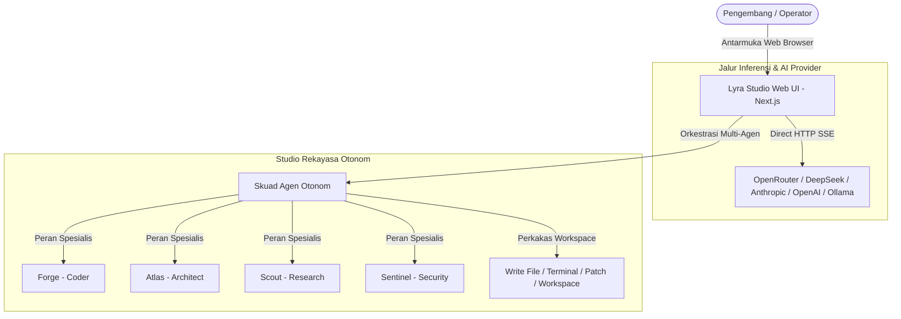

# 🌌 Lyra Studio (Orkestrator AI Multi-Agen Otonom)

<p align="center">
  <strong>Ruang kerja dan antarmuka studio orkestrasi multi-agen otonom kelas enterprise.</strong>
</p>

<p align="center">
  <a href="#-fitur-utama">Fitur Utama</a> •
  <a href="#-arsitektur-sistem">Arsitektur</a> •
  <a href="#-panduan-instalasi-cepat">Instalasi</a> •
  <a href="#-skuad-agen-spesialis">Skuad Agen</a> •
  <a href="README.md">English Version</a>
</p>

---

## 🌟 Sekilas Pandang

**Lyra Studio** adalah platform orkestrasi kecerdasan buatan (*AI Orchestration*) kelas enterprise yang dirancang sebagai pusat komando visual untuk ekosistem agen otonom. Platform ini memadukan antarmuka web modern berskala produksi dengan arsitektur streaming berkecepatan tinggi, memberikan akses instan ke kemampuan penalaran LLM, manipulasi berkas di ruang kerja, serta koordinasi tim agen (*swarm*) yang mandiri.

Baik Anda menggunakan model lokal (via Ollama), layanan komputasi awan (OpenRouter, DeepSeek, Anthropic, OpenAI, Groq), maupun terhubung langsung ke mesin runtime otonom seperti Hermes Agent, Lyra Studio memberikan eksekusi latensi rendah dalam lingkungan yang aman dan terisolasi.

---

## ✨ Fitur Utama

- **⚡ Interaksi Jalur Ganda (Dual-Engine Interaction)**:
  - **Mode Obrolan Langsung (`/chat`)**: Langsung terhubung via HTTP SSE streaming ke provider apa pun yang kompatibel dengan standar OpenAI. *Zero-setup*, tidak memerlukan instalasi CLI atau dependensi Python eksternal.
  - **Studio Agen Otonom (`/work`)**: Menjalankan orkestrasi terminal secara real-time, pengeditan berkas multi-file, dan perencanaan daftar tugas (*dynamic todos*) mandiri.
- **🤖 Skuad 9 Agen Spesialis Bawaan (*Out-of-the-Box*)**: Sistem otomatis membangkitkan 9 persona agen spesialis (*Software Engineering, System Architect, Deep Research, QA, Security Officer, Verifier, Synthesis Lead*) lengkap dengan arahan SOUL/protokol otonom.
- **🌐 Dukungan Penyedia & Model AI Universal**: Terintegrasi penuh dengan OpenRouter, OpenAI, Anthropic Claude, DeepSeek (V3 & R1 Reasoning), Google Gemini, Groq, Mistral, Ollama lokal, serta Custom API endpoint.
- **📁 File Explorer & Live Workspace**: Penjelajah berkas interaktif dengan simulasi pengetikan kode langsung (*live typing*), editor sintaksis, dan penautan konteks file otomatis.
- **🌓 Antarmuka Dwibahasa Bersih (ID / EN)**: UI modern bebas distraksi dengan dukungan penuh Bahasa Indonesia & Bahasa Inggris, ditenagai Next.js dan Tailwind CSS.
- **🔒 Privasi Terjaga (Zero-Leak Security)**: Kredensial dan API Key tersimpan di environment lokal Anda dan tidak pernah terekspos ke repositori publik.

---

## 🏗️ Arsitektur Sistem



---

## 🚀 Panduan Instalasi Cepat

### 1. Kebutuhan Sistem
- **Node.js**: Versi `v20.x` atau lebih baru
- **npm** atau **pnpm**

### 2. Langkah Instalasi

Clone repositori dan pasang dependensi:

```bash
# Clone repositori
git clone https://github.com/Kal215/lyrav2.git
cd lyrav2/web

# Pasang dependensi
npm install

# Jalankan server pengembangan
npm run dev
```

Buka peramban (browser) di alamat **`http://localhost:3000`**.

### 3. Konfigurasi Penyedia AI Anda
1. Buka menu **Settings** (`/settings`).
2. Pilih penyedia AI yang Anda gunakan (*OpenRouter, OpenAI, DeepSeek, Groq, Ollama, dll.*).
3. Masukkan **API Key** dan pilih model default Anda.
4. Klik **Simpan Konfigurasi**.
5. Anda bisa langsung mengobrol di menu `/chat` atau menjalankan proyek otonom di `/work`!

*(Opsional: Jika Anda telah memiliki lingkungan Hermes Agent lokal, Lyra Studio akan otomatis tersinkronisasi dengan konfigurasi yang ada).*

---

## 👥 Skuad Agen Spesialis Bawaan

Saat pertama kali dijalankan, sistem secara otomatis mengonfigurasi dan membangkitkan skuad agen berikut:

| Agen | Nama Panggilan | Peran Spesialis | Tanggung Jawab Utama |
| :--- | :--- | :--- | :--- |
| **Coder** | `@Forge` | Senior Engineer | Menulis kode bersih, refactoring, dan pengujian unit. |
| **Planner** | `@Atlas` | System Architect | Membedah kebutuhan proyek menjadi langkah kerja terstruktur. |
| **Researcher** | `@Scout` | Intelligence Lead | Riset web mendalam, ekstraksi data faktual, dan pencarian dokumen. |
| **QA** | `@Iris` | Quality Assurance | Memeriksa stabilitas kode, bug regression, dan edge cases. |
| **Security** | `@Sentinel` | Security Officer | Audit izin akses, deteksi kerentanan, dan perlindungan rahasia/token. |
| **Verifier** | `@Nova` | Verification | Memverifikasi hasil kerja terhadap kriteria penerimaan tugas. |
| **Synthesizer** | `@Echo` | Integration Lead | Menyatukan keluaran agen menjadi deliverable final yang siap rilis. |

---

## 📄 Dokumentasi Bahasa Inggris

Dokumentasi dalam Bahasa Inggris tersedia di: **[README.md](README.md)**.

---

## 🛡️ Lisensi

Lisensi MIT. Bebas digunakan untuk keperluan personal, akademik, maupun pengembangan open-source komersial.

---
*Dibuat oleh [M. Riskal Fadhilla] - Cloud DevOps & AI Integration Engineer.*
