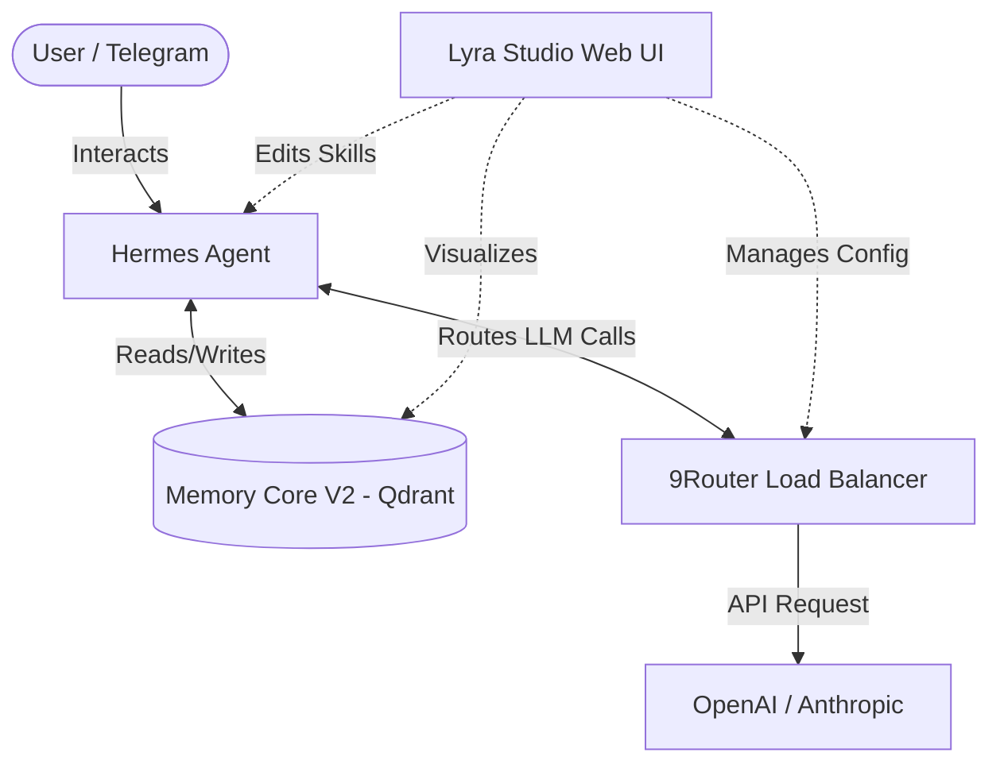

# 🌌 Lyra Studio (Autonomous AI Orchestrator)

**Lyra Studio** is an enterprise-grade AI orchestration platform designed to serve as the brain for autonomous AI agents (like Hermes). It provides a beautiful Next.js Web UI paired with a robust Python/Node.js backend for Load Balancing and Long-Term Memory.


## ✨ Key Features

- **🎨 Studio Web UI**: A sleek, dark-themed dashboard (Next.js + Tailwind) to manage your AI ecosystem without touching terminal YAML files.
- **⚖️ 9Router (LLM Proxy)**: A local load-balancer that manages multiple LLM Provider API keys with strict-priority routing and failover capabilities.
- **🧠 Memory Core V2**: A dual-layer long-term memory system utilizing Qdrant (Vector DB) and Mem0 to ensure your AI never forgets user context.
- **🔐 Secure by Design**: Zero-trust architecture. API Keys are injected securely; no credentials are ever hardcoded.
- **⚡ Skill Workspace**: A built-in Markdown IDE to create, edit, and manage Agent Skills visually.

## 🏗️ Architecture



## 🚀 Quick Start (One-Click Install)

```bash
curl -sL https://raw.githubusercontent.com/mrf/lyra-stack/main/install.sh | bash
```
*This will automatically pull the Docker containers and start the Next.js Studio UI on port 3000.*

---
*Created by [M. Riskal Fadhilla] - Cloud DevOps & AI Integration Engineer.*
