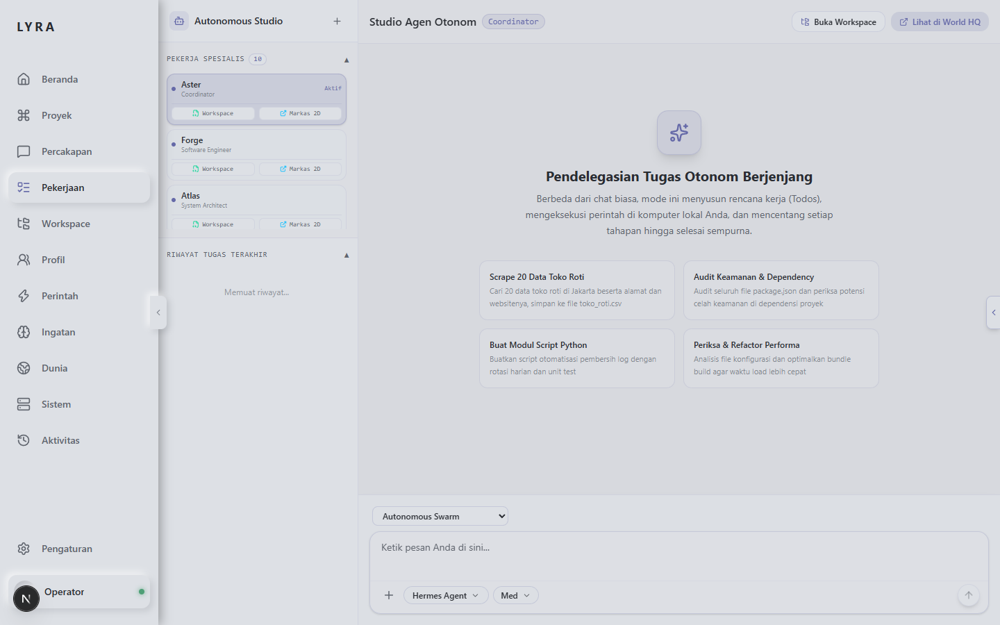
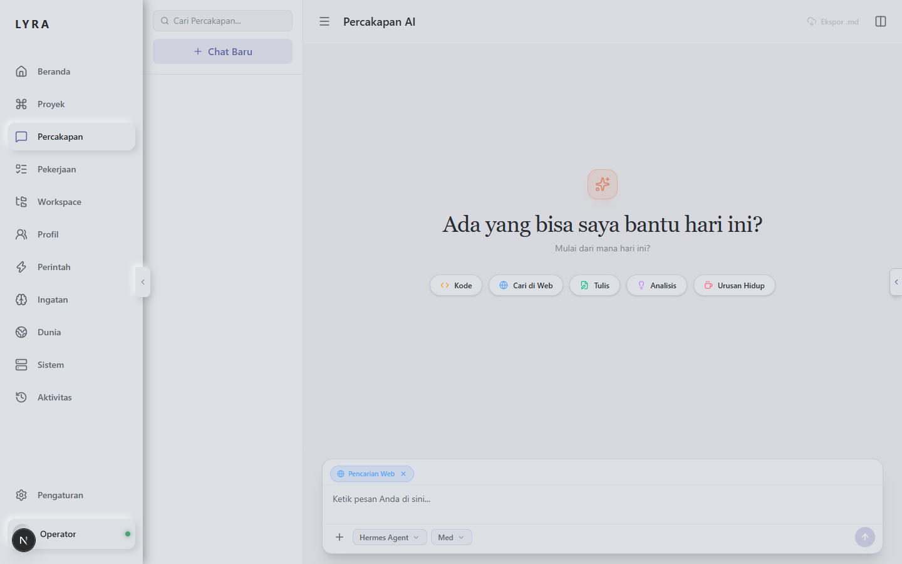
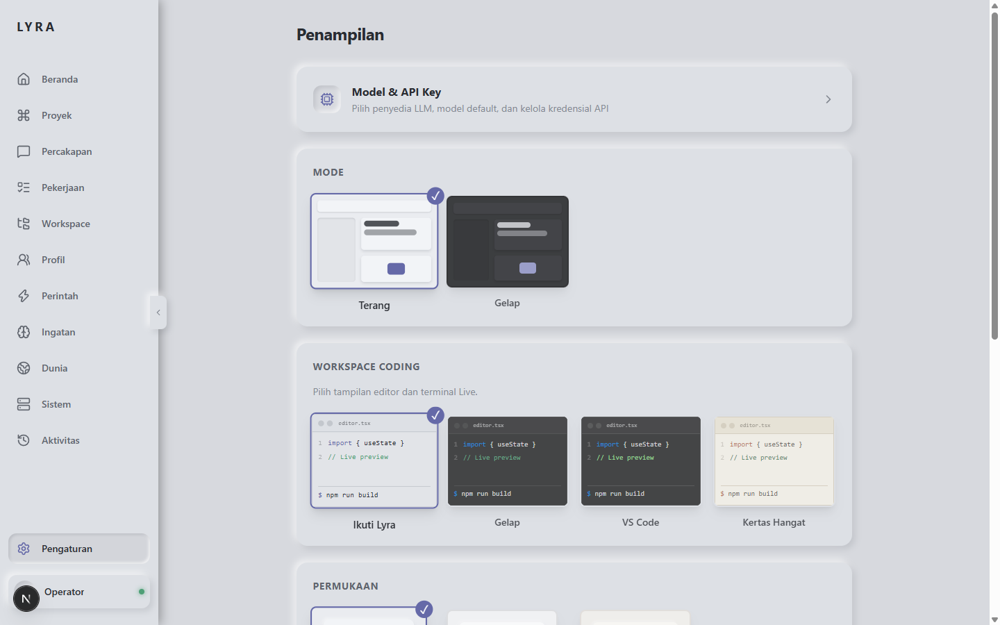

# Lyra Studio

A modern web interface and multi-agent workspace for autonomous AI development.



[Features](#features) • [Quick Start](#quick-start) • [Agent Architecture](#agent-architecture) • [Screenshots](#screenshots) • [Configuration](#configuration) • [Bahasa Indonesia](README.id.md)

---

## Overview

Lyra Studio is an open-source developer workspace designed for interacting with LLMs and orchestrating multi-agent systems. Built with Next.js and Tailwind CSS, it offers two complementary interaction modes:

1. **Direct Chat (`/chat`)**: Direct HTTP Server-Sent Events (SSE) streaming to any OpenAI-compatible endpoint (OpenRouter, DeepSeek, Anthropic, OpenAI, Groq, Ollama). Requires no local runtime or CLI dependencies.
2. **Autonomous Studio (`/work`)**: Agent-driven workspace supporting real-time file tree modifications, tool execution tracking, reasoning visibility, and task coordination.

---

## Screenshots

| Autonomous Studio (`/work`) | Direct Chat (`/chat`) |
| :---: | :---: |
|  |  |

| Model & Provider Settings (`/settings`) |
| :---: |
|  |

---

## Features

- **Direct & Zero-Config Chat**: Stream responses with real-time thinking/reasoning inspection (`<think>` tags) and formatted Markdown output.
- **Pre-Configured Specialist Squad**: Includes 9 pre-defined agent roles with scoped system prompts (Engineer, Architect, Researcher, QA, Security, Verifier, Synthesizer).
- **Multi-Provider Support**: Switch seamlessly between cloud providers (OpenRouter, OpenAI, Anthropic, DeepSeek, Groq) and local inference servers (Ollama, vLLM).
- **Interactive Workspace**: Built-in file explorer, syntax-highlighted code viewer, and contextual file tagging.
- **Bilingual Interface**: Native support for English and Indonesian across all views.
- **Privacy First**: API keys and environment configurations are stored locally on your machine and excluded from version control.

---

## Quick Start

### Prerequisites
- Node.js 20.x or higher
- npm or pnpm

### Installation

```bash
git clone https://github.com/Kal215/Lyra-webui-hermes.git
cd Lyra-webui-hermes/web
npm install
npm run dev
```

Open [http://localhost:3000](http://localhost:3000) in your browser.

### Setup API Keys

1. Navigate to **Settings** (`/settings`).
2. Select your provider (OpenRouter, OpenAI, DeepSeek, Groq, or Custom).
3. Enter your API Key and choose your default model.
4. Click **Save Configuration**.

---

## Agent Architecture

Lyra Studio includes built-in specialist personas for structured development workflows:

| Role | Identifier | Focus Area |
| :--- | :--- | :--- |
| Senior Engineer | `Forge` (`coder`) | Implementation, code refactoring, test execution |
| System Architect | `Atlas` (`planner`) | Architectural design, task decomposition, roadmaps |
| Research Specialist | `Scout` (`researcher`) | Documentation review, web research, factual verification |
| QA Engineer | `Iris` (`qa`) | Edge-case analysis, regression checks, validation |
| Security Officer | `Sentinel` (`security`) | Permission review, vulnerability scanning, secret isolation |
| Verifier | `Nova` (`verifier`) | Acceptance criteria review, diff verification |
| Integration Lead | `Echo` (`synthesizer`) | Cross-agent synthesis, documentation, final reporting |

---

## Project Structure

```
web/
├── src/
│   ├── app/                 # Next.js App Router (chat, work, settings, memory, etc.)
│   │   ├── api/             # Backend API routes (chat-stream, settings, workspace)
│   │   ├── chat/            # Chat interface with streaming & thinking accordion
│   │   ├── work/            # Autonomous studio with dynamic todos & tool feed
│   │   └── settings/        # Model selection & API credentials manager
│   ├── components/          # Reusable UI components (workspace, shell, sidebar)
│   ├── lib/                 # Core utilities, reasoning extractor, profile bootstrap
│   └── store/               # Zustand state stores
```

---

## License

MIT License. Free for open-source, educational, and commercial use.

---
*Created by [M. Riskal Fadhilla] — Cloud DevOps & AI Integration Engineer.*
