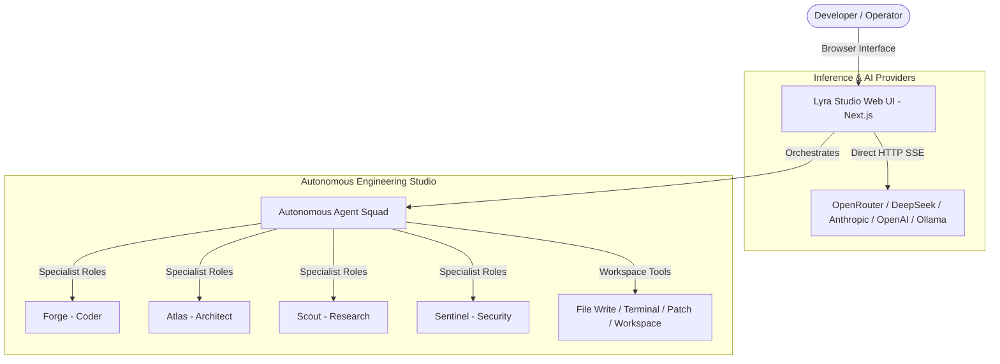

# 🌌 Lyra Studio (Autonomous AI Orchestrator)

<p align="center">
  <strong>An enterprise-grade, autonomous multi-agent orchestration workspace and studio interface.</strong>
</p>

<p align="center">
  <a href="#-key-features">Features</a> •
  <a href="#-architecture">Architecture</a> •
  <a href="#-quick-start">Quick Start</a> •
  <a href="#-agent-squad">Agent Squad</a> •
  <a href="README.id.md">Bahasa Indonesia</a>
</p>

---

## 🌟 Overview

**Lyra Studio** is an enterprise-grade AI orchestration platform designed to serve as the visual command center for multi-agent autonomous engineering. It combines an ultra-refined web interface with a high-performance streaming architecture, giving you direct access to LLM reasoning, code workspace manipulation, and coordinated autonomous agent swarms.

Whether you run local open models via Ollama, cloud inference engines (OpenRouter, DeepSeek, Anthropic, OpenAI, Groq), or connect into native autonomous runtimes like Hermes Agent, Lyra Studio provides zero-latency execution in an isolated, secure environment.

---

## ✨ Key Features

- **⚡ Dual-Engine Interaction**:
  - **Direct API Mode (`/chat`)**: Zero-setup, instant direct HTTP SSE streaming to any OpenAI-compatible provider. No local CLI or external dependencies required.
  - **Autonomous Agent Studio (`/work`)**: Real-time terminal orchestration, autonomous multi-file edits, and dynamic todo task planning powered by agent runtime integration.
- **🤖 Out-of-the-Box Specialist Squad**: Auto-provisions 9 specialized agent personas (Software Engineering, System Architecture, Deep Research, QA, Security Auditing, Verification, Synthesis) with self-contained SOUL directives.
- **🌐 Universal Model & Provider Support**: First-class support for OpenRouter, OpenAI, Anthropic, DeepSeek, Google Gemini, Groq, Mistral, Ollama, and custom private endpoints.
- **📁 Integrated Workspace Explorer**: Interactive file tree with live typing simulation, syntax-highlighted code editor, and file-context tagging.
- **🌓 Bilingual Enterprise UI (ID / EN)**: Fully localized, distraction-free interface built with Next.js, Tailwind CSS, and GitHub-Flavored Markdown rendering.
- **🔒 Zero-Leak Privacy Design**: Local environment keys, sandboxed configuration paths, and automatic secret sanitization.

---

## 🏗️ Architecture



---

## 🚀 Quick Start

### 1. Prerequisites
- **Node.js**: `v20.x` or later
- **npm** or **pnpm**

### 2. Installation

Clone the repository and install dependencies:

```bash
# Clone the repository
git clone https://github.com/Kal215/lyrav2.git
cd lyrav2/web

# Install dependencies
npm install

# Run the development server
npm run dev
```

Open your browser at **`http://localhost:3000`**.

### 3. Configure Your AI Provider
1. Navigate to **Settings** (`/settings`).
2. Select your provider of choice (*OpenRouter, OpenAI, DeepSeek, Groq, Ollama, etc.*).
3. Paste your API Key and select your default model.
4. Click **Simpan Konfigurasi / Save Configuration**.
5. Start chatting immediately in `/chat` or launch multi-agent projects in `/work`!

*(Optional: If you already run a local Hermes Agent environment, Lyra Studio will seamlessly pair with your existing configuration).*

---

## 👥 Pre-Configured Agent Squad

Lyra Studio automatically initializes a coordinated squad of specialized agents on first launch:

| Agent | Name | Role | Primary Objective |
| :--- | :--- | :--- | :--- |
| **Coder** | `@Forge` | Senior Engineer | Implements clean code, refactors, and runs automated tests. |
| **Planner** | `@Atlas` | System Architect | Decomposes complex briefs into sequenced, actionable milestones. |
| **Researcher** | `@Scout` | Intelligence | Performs deep web research, verifies facts, and retrieves documentation. |
| **QA** | `@Iris` | QA Engineer | Scrutinizes code, designs edge-case tests, and ensures stability. |
| **Security** | `@Sentinel` | Security Officer | Audits attack surfaces, safeguards environment secrets, and checks dependencies. |
| **Verifier** | `@Nova` | Verification | Validates deliverables against original acceptance criteria before sign-off. |
| **Synthesizer** | `@Echo` | Integration Lead | Unifies findings into cohesive, production-ready deliverables. |

---

## 📄 Documentation in Indonesian

Dokumentasi lengkap dalam Bahasa Indonesia tersedia di: **[README.id.md](README.id.md)**.

---

## 🛡️ License

MIT License. Free for personal, academic, and commercial open-source usage.

---
*Created by [M. Riskal Fadhilla] - Cloud DevOps & AI Integration Engineer.*
